# Database Schema: Urban Escape PHMS

Generated by `tools/schema_doc.php` from database `nairobi_property_db` on 21 November 2026. Do not edit by hand; change `database/schema.sql` and add a migration, then regenerate.

| Item | Value |
| --- | --- |
| DBMS | 10.4.32-MariaDB (MySQL-compatible), InnoDB, utf8mb4 |
| Tables | 26 |
| Columns | 260 |
| Foreign keys | 49 |
| Fresh install | `database/schema.sql`, then `database/seed.sql` (development) or `database/reference_data.sql` (production) |
| Upgrade path | `database/migrations/001` to `003`, applied in order; each is safe to re-run |

A fresh install from `schema.sql` and a database upgraded with the migrations have identical tables, columns, indexes and foreign keys.

## Contents

- **Access and security:** [`roles`](#roles), [`users`](#users), [`login_attempts`](#login_attempts), [`audit_logs`](#audit_logs)
- **Portfolio:** [`locations`](#locations), [`landlords`](#landlords), [`properties`](#properties), [`units`](#units)
- **Tenancy:** [`tenants`](#tenants), [`leases`](#leases), [`condition_reports`](#condition_reports), [`condition_report_items`](#condition_report_items), [`documents`](#documents)
- **Billing and finance:** [`rent_charges`](#rent_charges), [`payments`](#payments), [`payment_allocations`](#payment_allocations), [`deposit_transactions`](#deposit_transactions), [`utility_types`](#utility_types), [`utility_readings`](#utility_readings), [`expenses`](#expenses)
- **Operations:** [`maintenance_requests`](#maintenance_requests), [`maintenance_updates`](#maintenance_updates), [`complaints`](#complaints), [`notifications`](#notifications)
- **Public website:** [`viewing_requests`](#viewing_requests), [`enquiries`](#enquiries)

## Entity relationship diagram

Primary keys, foreign keys and unique keys are shown; see the data dictionary for every column. `||--o{` means one to many with a required parent; `|o--o{` means the parent is optional (nullable foreign key).

```mermaid
erDiagram
    users |o--o{ audit_logs : "user_id"
    users |o--o{ complaints : "assigned_to"
    properties ||--o{ complaints : "property_id"
    tenants ||--o{ complaints : "tenant_id"
    users ||--o{ condition_reports : "inspected_by"
    leases ||--o{ condition_reports : "lease_id"
    condition_reports ||--o{ condition_report_items : "report_id"
    users ||--o{ deposit_transactions : "recorded_by"
    condition_reports |o--o{ deposit_transactions : "condition_report_id"
    leases ||--o{ deposit_transactions : "lease_id"
    users ||--o{ documents : "uploaded_by"
    tenants |o--o{ documents : "tenant_id"
    properties |o--o{ documents : "property_id"
    users |o--o{ enquiries : "handled_by"
    properties ||--o{ expenses : "property_id"
    users ||--o{ expenses : "recorded_by"
    users |o--o{ landlords : "user_id"
    units ||--o{ leases : "unit_id"
    properties ||--o{ leases : "property_id"
    tenants ||--o{ leases : "tenant_id"
    users |o--o{ maintenance_requests : "assigned_staff"
    units ||--o{ maintenance_requests : "unit_id"
    properties ||--o{ maintenance_requests : "property_id"
    tenants ||--o{ maintenance_requests : "tenant_id"
    users |o--o{ maintenance_updates : "updated_by"
    maintenance_requests ||--o{ maintenance_updates : "request_id"
    users ||--o{ notifications : "user_id"
    leases ||--o{ payments : "lease_id"
    units ||--o{ payments : "unit_id"
    properties ||--o{ payments : "property_id"
    tenants ||--o{ payments : "tenant_id"
    users ||--o{ payments : "recorded_by"
    rent_charges ||--o{ payment_allocations : "rent_charge_id"
    payments ||--o{ payment_allocations : "payment_id"
    landlords ||--o{ properties : "landlord_id"
    users |o--o{ properties : "caretaker_id"
    locations ||--o{ properties : "location_id"
    units ||--o{ rent_charges : "unit_id"
    tenants ||--o{ rent_charges : "tenant_id"
    leases ||--o{ rent_charges : "lease_id"
    users |o--o{ tenants : "user_id"
    landlords |o--o{ tenants : "landlord_id"
    properties ||--o{ units : "property_id"
    roles ||--o{ users : "role_id"
    users ||--o{ utility_readings : "recorded_by"
    utility_types ||--o{ utility_readings : "utility_type_id"
    units ||--o{ utility_readings : "unit_id"
    units |o--o{ viewing_requests : "unit_id"
    properties ||--o{ viewing_requests : "property_id"
    audit_logs {
        int id PK
        int user_id FK
    }
    complaints {
        int id PK
        int tenant_id FK
        int property_id FK
        int assigned_to FK
    }
    condition_reports {
        int id PK
        int lease_id FK
        int inspected_by FK
    }
    condition_report_items {
        int id PK
        int report_id FK
    }
    deposit_transactions {
        int id PK
        int lease_id FK
        int condition_report_id FK
        int recorded_by FK
    }
    documents {
        int id PK
        int property_id FK
        int tenant_id FK
        int uploaded_by FK
    }
    enquiries {
        int id PK
        int handled_by FK
    }
    expenses {
        int id PK
        int property_id FK
        int recorded_by FK
    }
    landlords {
        int id PK
        int user_id FK
    }
    leases {
        int id PK
        int tenant_id FK
        int property_id FK
        int unit_id FK
    }
    locations {
        int id PK
    }
    login_attempts {
        int id PK
    }
    maintenance_requests {
        int id PK
        int tenant_id FK
        int property_id FK
        int unit_id FK
        int assigned_staff FK
    }
    maintenance_updates {
        int id PK
        int request_id FK
        int updated_by FK
    }
    notifications {
        int id PK
        int user_id FK
    }
    payments {
        int id PK
        varchar receipt_number UK
        int tenant_id FK
        int property_id FK
        int unit_id FK
        int lease_id FK
        varchar transaction_reference UK
        int recorded_by FK
    }
    payment_allocations {
        int id PK
        int payment_id FK
        int rent_charge_id FK
    }
    properties {
        int id PK
        int landlord_id FK
        int caretaker_id FK
        int location_id FK
    }
    rent_charges {
        int id PK
        int lease_id FK
        int tenant_id FK
        int unit_id FK
    }
    roles {
        int id PK
        varchar name UK
    }
    tenants {
        int id PK
        int user_id FK
        int landlord_id FK
        varchar national_id UK
    }
    units {
        int id PK
        int property_id FK
    }
    users {
        int id PK
        int role_id FK
        varchar email UK
    }
    utility_readings {
        int id PK
        int unit_id FK
        int utility_type_id FK
        int recorded_by FK
    }
    utility_types {
        int id PK
    }
    viewing_requests {
        int id PK
        int property_id FK
        int unit_id FK
    }
```

## Data dictionary

Key: **PK** primary key, **FK** foreign key (with its ON DELETE rule), **UK** unique, **IX** indexed. Every table uses the InnoDB engine.

### Access and security

#### roles

The six user roles: Super Admin, Property Manager, Landlord, Caretaker, Accountant, Tenant.

| Column | Type | Null | Default | Key | Notes |
| --- | --- | --- | --- | --- | --- |
| `id` | int(11) | No |  | PK | auto increment |
| `name` | varchar(50) | No |  | UK |  |
| `description` | varchar(255) | Yes |  |  |  |
| `created_at` | timestamp | No | current_timestamp() |  |  |

#### users

Sign-in accounts. Passwords are stored only as bcrypt hashes; only Active accounts can sign in.

| Column | Type | Null | Default | Key | Notes |
| --- | --- | --- | --- | --- | --- |
| `id` | int(11) | No |  | PK | auto increment |
| `role_id` | int(11) | No |  | FK | → `roles.id`, on delete restrict |
| `full_name` | varchar(100) | No |  |  |  |
| `email` | varchar(150) | No |  | UK |  |
| `phone` | varchar(20) | No |  |  |  |
| `password_hash` | varchar(255) | No |  |  |  |
| `status` | enum('Active','Inactive','Suspended') | Yes | Active |  |  |
| `last_login` | timestamp | Yes |  |  |  |
| `created_at` | timestamp | No | current_timestamp() |  |  |
| `updated_at` | timestamp | No | current_timestamp() |  | updated automatically on change |

#### login_attempts

Failed sign-ins, used to block an email after 5 failures (or an IP after 20) in 15 minutes. Rows older than a day are removed.

| Column | Type | Null | Default | Key | Notes |
| --- | --- | --- | --- | --- | --- |
| `id` | int(11) | No |  | PK | auto increment |
| `email` | varchar(150) | No |  | IX |  |
| `ip_address` | varchar(45) | No |  | IX |  |
| `attempted_at` | timestamp | No | current_timestamp() |  |  |

Index `idx_login_attempts_email` on (email, attempted_at).

Index `idx_login_attempts_ip` on (ip_address, attempted_at).

#### audit_logs

Who did what and when, with before and after values (secrets removed) for changes to records.

| Column | Type | Null | Default | Key | Notes |
| --- | --- | --- | --- | --- | --- |
| `id` | int(11) | No |  | PK | auto increment |
| `user_id` | int(11) | Yes |  | FK | → `users.id`, on delete set null |
| `action` | varchar(100) | No |  |  |  |
| `module` | varchar(50) | No |  |  |  |
| `record_id` | int(11) | Yes |  |  |  |
| `description` | text | No |  |  |  |
| `old_values` | text | Yes |  |  |  |
| `new_values` | text | Yes |  |  |  |
| `ip_address` | varchar(45) | Yes |  |  |  |
| `created_at` | timestamp | No | current_timestamp() | IX |  |

### Portfolio

#### locations

Estates and sub-counties used to file and search properties.

| Column | Type | Null | Default | Key | Notes |
| --- | --- | --- | --- | --- | --- |
| `id` | int(11) | No |  | PK | auto increment |
| `county` | varchar(100) | Yes | Nairobi |  |  |
| `sub_county` | varchar(100) | No |  |  |  |
| `estate` | varchar(100) | No |  |  |  |
| `created_at` | timestamp | No | current_timestamp() |  |  |

#### landlords

Property owners, optionally linked to a Landlord sign-in account.

| Column | Type | Null | Default | Key | Notes |
| --- | --- | --- | --- | --- | --- |
| `id` | int(11) | No |  | PK | auto increment |
| `user_id` | int(11) | Yes |  | FK | → `users.id`, on delete set null |
| `full_name` | varchar(100) | No |  |  |  |
| `company_name` | varchar(150) | Yes |  |  |  |
| `phone` | varchar(20) | No |  |  |  |
| `email` | varchar(150) | No |  |  |  |
| `id_number` | varchar(50) | No |  |  |  |
| `address` | text | Yes |  |  |  |
| `bank_details` | text | Yes |  |  |  |
| `mpesa_number` | varchar(20) | Yes |  |  |  |
| `status` | enum('Active','Inactive') | Yes | Active |  |  |
| `created_at` | timestamp | No | current_timestamp() |  |  |

#### properties

Buildings, each owned by one landlord and optionally looked after by one caretaker.

| Column | Type | Null | Default | Key | Notes |
| --- | --- | --- | --- | --- | --- |
| `id` | int(11) | No |  | PK | auto increment |
| `landlord_id` | int(11) | No |  | FK | → `landlords.id`, on delete restrict |
| `caretaker_id` | int(11) | Yes |  | FK | → `users.id`, on delete set null |
| `name` | varchar(150) | No |  |  |  |
| `property_type` | enum('Apartment','Flats','Bedsitters','Maisonettes','Townhouses','Commercial','Student Housing','Mixed Use','Single Family','Other') | No |  |  |  |
| `description` | text | Yes |  |  |  |
| `location_id` | int(11) | No |  | FK | → `locations.id`, on delete restrict |
| `physical_address` | varchar(255) | No |  |  |  |
| `latitude` | decimal(10,8) | Yes |  |  |  |
| `longitude` | decimal(11,8) | Yes |  |  |  |
| `number_of_units` | int(11) | No | 0 |  |  |
| `year_built` | year(4) | Yes |  |  |  |
| `amenities` | text | Yes |  |  |  |
| `status` | enum('Active','Under Maintenance','Archived') | Yes | Active |  |  |
| `property_image` | varchar(255) | Yes |  |  |  |
| `created_at` | timestamp | No | current_timestamp() |  |  |
| `updated_at` | timestamp | No | current_timestamp() |  | updated automatically on change |

#### units

Rentable houses or rooms within a property, with rent, deposit, billing methods and status.

| Column | Type | Null | Default | Key | Notes |
| --- | --- | --- | --- | --- | --- |
| `id` | int(11) | No |  | PK | auto increment |
| `property_id` | int(11) | No |  | FK | → `properties.id`, on delete cascade |
| `unit_number` | varchar(50) | No |  |  |  |
| `floor` | varchar(20) | Yes | Ground |  |  |
| `house_type` | enum('Bedsitter','Studio','1 Bedroom','2 Bedroom','3 Bedroom','4 Bedroom','Maisonette','Shop','Office','Other') | No |  |  |  |
| `bedrooms` | int(11) | Yes | 1 |  |  |
| `bathrooms` | int(11) | Yes | 1 |  |  |
| `monthly_rent` | decimal(12,2) | No |  |  |  |
| `deposit` | decimal(12,2) | No |  |  |  |
| `service_charge` | decimal(12,2) | Yes | 0.00 |  |  |
| `water_billing_method` | enum('Meter Reading','Fixed Rate','Per Unit','Shared') | Yes | Meter Reading |  |  |
| `electricity_billing_method` | enum('Prepaid','Postpaid Sub-Meter','Fixed') | Yes | Prepaid |  |  |
| `status` | enum('Vacant','Occupied','Reserved','Under Maintenance','Unavailable') | Yes | Vacant |  |  |
| `description` | text | Yes |  |  |  |
| `created_at` | timestamp | No | current_timestamp() |  |  |

Unique key `unique_property_unit` on (property_id, unit_number).

### Tenancy

#### tenants

Tenant profiles, optionally linked to a Tenant sign-in account and to the landlord who registered them.

| Column | Type | Null | Default | Key | Notes |
| --- | --- | --- | --- | --- | --- |
| `id` | int(11) | No |  | PK | auto increment |
| `user_id` | int(11) | Yes |  | FK | → `users.id`, on delete set null |
| `landlord_id` | int(11) | Yes |  | FK | → `landlords.id`, on delete set null |
| `full_name` | varchar(100) | No |  |  |  |
| `phone` | varchar(20) | No |  |  |  |
| `email` | varchar(150) | No |  |  |  |
| `national_id` | varchar(50) | No |  | UK |  |
| `gender` | enum('Male','Female','Other') | No |  |  |  |
| `date_of_birth` | date | Yes |  |  |  |
| `emergency_contact_name` | varchar(100) | Yes |  |  |  |
| `emergency_contact_phone` | varchar(20) | Yes |  |  |  |
| `occupation` | varchar(100) | Yes |  |  |  |
| `employer` | varchar(100) | Yes |  |  |  |
| `current_address` | text | Yes |  |  |  |
| `profile_photo` | varchar(255) | Yes |  |  |  |
| `status` | enum('Active','Inactive','Evicted','Blacklisted') | Yes | Active |  |  |
| `created_at` | timestamp | No | current_timestamp() |  |  |

#### leases

Tenancy agreements between a tenant and a unit: dates, rent, deposit, due day, notice period and status.

| Column | Type | Null | Default | Key | Notes |
| --- | --- | --- | --- | --- | --- |
| `id` | int(11) | No |  | PK | auto increment |
| `tenant_id` | int(11) | No |  | FK | → `tenants.id`, on delete restrict |
| `property_id` | int(11) | No |  | FK | → `properties.id`, on delete restrict |
| `unit_id` | int(11) | No |  | FK | → `units.id`, on delete restrict |
| `start_date` | date | No |  |  |  |
| `end_date` | date | No |  |  |  |
| `monthly_rent` | decimal(12,2) | No |  |  |  |
| `deposit` | decimal(12,2) | No |  |  |  |
| `payment_due_day` | int(11) | Yes | 5 |  |  |
| `notice_period_days` | int(11) | Yes | 30 |  |  |
| `rent_review_date` | date | Yes |  |  |  |
| `status` | enum('Active','Expired','Terminated','Pending','Renewed') | Yes | Pending |  |  |
| `special_terms` | text | Yes |  |  |  |
| `document_path` | varchar(255) | Yes |  |  |  |
| `created_at` | timestamp | No | current_timestamp() |  |  |

#### condition_reports

Move-in and move-out inspections of a lease (at most one of each), with the tenant's response.

| Column | Type | Null | Default | Key | Notes |
| --- | --- | --- | --- | --- | --- |
| `id` | int(11) | No |  | PK | auto increment |
| `lease_id` | int(11) | No |  | FK | → `leases.id`, on delete restrict |
| `report_type` | enum('Move-in','Move-out') | No |  |  |  |
| `inspection_date` | date | No |  |  |  |
| `overall_condition` | enum('Excellent','Good','Fair','Poor') | No |  |  |  |
| `general_notes` | text | Yes |  |  |  |
| `inspected_by` | int(11) | No |  | FK | → `users.id`, on delete restrict |
| `tenant_response` | enum('Pending','Agreed','Disputed') | No | Pending |  |  |
| `tenant_comment` | text | Yes |  |  |  |
| `responded_at` | timestamp | Yes |  |  |  |
| `created_at` | timestamp | No | current_timestamp() |  |  |

Unique key `unique_lease_report` on (lease_id, report_type).

#### condition_report_items

One checklist line per area of the unit in a condition report, with an optional photo.

| Column | Type | Null | Default | Key | Notes |
| --- | --- | --- | --- | --- | --- |
| `id` | int(11) | No |  | PK | auto increment |
| `report_id` | int(11) | No |  | FK | → `condition_reports.id`, on delete cascade |
| `area` | varchar(60) | No |  |  |  |
| `item_condition` | enum('Good','Fair','Poor','Damaged','Missing') | No |  |  |  |
| `remarks` | varchar(255) | Yes |  |  |  |
| `photo_path` | varchar(255) | Yes |  |  |  |

Unique key `unique_report_area` on (report_id, area).

#### documents

Reserved for lease, ID and other documents (not yet used by the interface).

| Column | Type | Null | Default | Key | Notes |
| --- | --- | --- | --- | --- | --- |
| `id` | int(11) | No |  | PK | auto increment |
| `property_id` | int(11) | Yes |  | FK | → `properties.id`, on delete cascade |
| `tenant_id` | int(11) | Yes |  | FK | → `tenants.id`, on delete cascade |
| `title` | varchar(150) | No |  |  |  |
| `document_type` | enum('Lease Agreement','ID Document','Receipt','Property Title','Maintenance Photo','Other') | No |  |  |  |
| `file_path` | varchar(255) | No |  |  |  |
| `uploaded_by` | int(11) | No |  | FK | → `users.id`, on delete restrict |
| `created_at` | timestamp | No | current_timestamp() |  |  |

### Billing and finance

#### rent_charges

Monthly invoices per lease: rent, service charge, utilities and any balance brought forward.

| Column | Type | Null | Default | Key | Notes |
| --- | --- | --- | --- | --- | --- |
| `id` | int(11) | No |  | PK | auto increment |
| `lease_id` | int(11) | No |  | FK | → `leases.id`, on delete cascade |
| `tenant_id` | int(11) | No |  | FK | → `tenants.id`, on delete cascade |
| `unit_id` | int(11) | No |  | FK | → `units.id`, on delete cascade |
| `billing_period` | varchar(20) | No |  |  |  |
| `rent_amount` | decimal(12,2) | No |  |  |  |
| `service_charge` | decimal(12,2) | Yes | 0.00 |  |  |
| `water_bill` | decimal(12,2) | Yes | 0.00 |  |  |
| `previous_balance` | decimal(12,2) | Yes | 0.00 |  |  |
| `total_due` | decimal(12,2) | No |  |  |  |
| `due_date` | date | No |  |  |  |
| `status` | enum('Unpaid','Partial','Paid','Overdue') | Yes | Unpaid |  |  |
| `created_at` | timestamp | No | current_timestamp() |  |  |

#### payments

Money received, with a unique receipt number and a unique transaction reference.

| Column | Type | Null | Default | Key | Notes |
| --- | --- | --- | --- | --- | --- |
| `id` | int(11) | No |  | PK | auto increment |
| `receipt_number` | varchar(50) | No |  | UK |  |
| `tenant_id` | int(11) | No |  | FK | → `tenants.id`, on delete restrict |
| `property_id` | int(11) | No |  | FK | → `properties.id`, on delete restrict |
| `unit_id` | int(11) | No |  | FK | → `units.id`, on delete restrict |
| `lease_id` | int(11) | No |  | FK | → `leases.id`, on delete restrict |
| `amount` | decimal(12,2) | No |  |  |  |
| `payment_method` | enum('M-Pesa','Bank','Cash','Card','Other') | No |  |  |  |
| `transaction_reference` | varchar(100) | No |  | UK |  |
| `payment_date` | date | No |  |  |  |
| `payment_period` | varchar(20) | No |  |  |  |
| `recorded_by` | int(11) | No |  | FK | → `users.id`, on delete restrict |
| `notes` | text | Yes |  |  |  |
| `created_at` | timestamp | No | current_timestamp() |  |  |

#### payment_allocations

How each payment is applied to charges, oldest charge first; rebuilt after every change.

| Column | Type | Null | Default | Key | Notes |
| --- | --- | --- | --- | --- | --- |
| `id` | int(11) | No |  | PK | auto increment |
| `payment_id` | int(11) | No |  | FK | → `payments.id`, on delete cascade |
| `rent_charge_id` | int(11) | No |  | FK | → `rent_charges.id`, on delete cascade |
| `allocated_amount` | decimal(12,2) | No |  |  |  |
| `created_at` | timestamp | No | current_timestamp() |  |  |

#### deposit_transactions

Deposit ledger per lease: deposits received, itemised deductions (with reasons) and refunds.

| Column | Type | Null | Default | Key | Notes |
| --- | --- | --- | --- | --- | --- |
| `id` | int(11) | No |  | PK | auto increment |
| `lease_id` | int(11) | No |  | FK | → `leases.id`, on delete restrict |
| `transaction_type` | enum('Received','Deduction','Refund') | No |  |  |  |
| `amount` | decimal(12,2) | No |  |  |  |
| `transaction_date` | date | No |  |  |  |
| `reason` | varchar(255) | Yes |  |  |  |
| `condition_report_id` | int(11) | Yes |  | FK | → `condition_reports.id`, on delete set null |
| `reference` | varchar(100) | Yes |  |  |  |
| `recorded_by` | int(11) | No |  | FK | → `users.id`, on delete restrict |
| `created_at` | timestamp | No | current_timestamp() |  |  |

#### utility_types

Billable utilities such as water and garbage collection, with a default rate.

| Column | Type | Null | Default | Key | Notes |
| --- | --- | --- | --- | --- | --- |
| `id` | int(11) | No |  | PK | auto increment |
| `name` | varchar(50) | No |  |  |  |
| `unit_of_measure` | varchar(20) | Yes | Units |  |  |
| `default_rate` | decimal(10,2) | No |  |  |  |
| `description` | varchar(255) | Yes |  |  |  |

#### utility_readings

Meter readings per unit and period; their totals flow into that period's rent charge.

| Column | Type | Null | Default | Key | Notes |
| --- | --- | --- | --- | --- | --- |
| `id` | int(11) | No |  | PK | auto increment |
| `unit_id` | int(11) | No |  | FK | → `units.id`, on delete cascade |
| `utility_type_id` | int(11) | No |  | FK | → `utility_types.id`, on delete restrict |
| `previous_reading` | decimal(10,2) | No |  |  |  |
| `current_reading` | decimal(10,2) | No |  |  |  |
| `consumption` | decimal(10,2) | No |  |  |  |
| `rate` | decimal(10,2) | No |  |  |  |
| `total_amount` | decimal(12,2) | No |  |  |  |
| `billing_period` | varchar(20) | No |  |  |  |
| `reading_date` | date | No |  |  |  |
| `recorded_by` | int(11) | No |  | FK | → `users.id`, on delete restrict |

#### expenses

Property running costs used by the income statement.

| Column | Type | Null | Default | Key | Notes |
| --- | --- | --- | --- | --- | --- |
| `id` | int(11) | No |  | PK | auto increment |
| `property_id` | int(11) | No |  | FK | → `properties.id`, on delete cascade |
| `category` | enum('Maintenance','Security','Utilities','Cleaning','Staff','Repairs','Management','Other') | No |  |  |  |
| `description` | varchar(255) | No |  |  |  |
| `amount` | decimal(12,2) | No |  |  |  |
| `expense_date` | date | No |  |  |  |
| `vendor` | varchar(150) | Yes |  |  |  |
| `receipt_path` | varchar(255) | Yes |  |  |  |
| `recorded_by` | int(11) | No |  | FK | → `users.id`, on delete restrict |
| `created_at` | timestamp | No | current_timestamp() |  |  |

### Operations

#### maintenance_requests

Repair requests from tenants, with priority, assignee, costs and an optional photo.

| Column | Type | Null | Default | Key | Notes |
| --- | --- | --- | --- | --- | --- |
| `id` | int(11) | No |  | PK | auto increment |
| `tenant_id` | int(11) | No |  | FK | → `tenants.id`, on delete cascade |
| `property_id` | int(11) | No |  | FK | → `properties.id`, on delete cascade |
| `unit_id` | int(11) | No |  | FK | → `units.id`, on delete cascade |
| `category` | enum('Plumbing','Electrical','Water','Security','Structural','Appliance','Cleaning','Other') | No |  |  |  |
| `description` | text | No |  |  |  |
| `priority` | enum('Low','Medium','High','Emergency') | Yes | Medium |  |  |
| `image_path` | varchar(255) | Yes |  |  |  |
| `status` | enum('Submitted','Reviewed','Assigned','In Progress','Waiting','Completed','Cancelled') | Yes | Submitted |  |  |
| `assigned_staff` | int(11) | Yes |  | FK | → `users.id`, on delete set null |
| `estimated_cost` | decimal(12,2) | Yes | 0.00 |  |  |
| `actual_cost` | decimal(12,2) | Yes | 0.00 |  |  |
| `created_at` | timestamp | No | current_timestamp() |  |  |
| `completed_date` | timestamp | Yes |  |  |  |

#### maintenance_updates

Time-stamped status history of each maintenance request.

| Column | Type | Null | Default | Key | Notes |
| --- | --- | --- | --- | --- | --- |
| `id` | int(11) | No |  | PK | auto increment |
| `request_id` | int(11) | No |  | FK | → `maintenance_requests.id`, on delete cascade |
| `status` | enum('Submitted','Reviewed','Assigned','In Progress','Waiting','Completed','Cancelled') | No |  |  |  |
| `note` | varchar(255) | Yes |  |  |  |
| `updated_by` | int(11) | Yes |  | FK | → `users.id`, on delete set null |
| `created_at` | timestamp | No | current_timestamp() |  |  |

#### complaints

Tenant complaints and management's resolution notes.

| Column | Type | Null | Default | Key | Notes |
| --- | --- | --- | --- | --- | --- |
| `id` | int(11) | No |  | PK | auto increment |
| `tenant_id` | int(11) | No |  | FK | → `tenants.id`, on delete cascade |
| `property_id` | int(11) | No |  | FK | → `properties.id`, on delete cascade |
| `category` | enum('Noise','Security','Water','Neighbors','Maintenance','Billing','Staff','Other') | No |  |  |  |
| `subject` | varchar(150) | No |  |  |  |
| `description` | text | No |  |  |  |
| `status` | enum('Open','Under Review','Resolved','Dismissed') | Yes | Open |  |  |
| `resolution_notes` | text | Yes |  |  |  |
| `assigned_to` | int(11) | Yes |  | FK | → `users.id`, on delete set null |
| `created_at` | timestamp | No | current_timestamp() |  |  |
| `updated_at` | timestamp | No | current_timestamp() |  | updated automatically on change |

#### notifications

In-app notices and alerts shown in each user's notification bell.

| Column | Type | Null | Default | Key | Notes |
| --- | --- | --- | --- | --- | --- |
| `id` | int(11) | No |  | PK | auto increment |
| `user_id` | int(11) | No |  | FK | → `users.id`, on delete cascade |
| `title` | varchar(150) | No |  |  |  |
| `message` | text | No |  |  |  |
| `is_read` | tinyint(1) | Yes | 0 |  |  |
| `created_at` | timestamp | No | current_timestamp() |  |  |

### Public website

#### viewing_requests

Requests from visitors to view a property.

| Column | Type | Null | Default | Key | Notes |
| --- | --- | --- | --- | --- | --- |
| `id` | int(11) | No |  | PK | auto increment |
| `property_id` | int(11) | No |  | FK | → `properties.id`, on delete cascade |
| `unit_id` | int(11) | Yes |  | FK | → `units.id`, on delete set null |
| `visitor_name` | varchar(100) | No |  |  |  |
| `visitor_phone` | varchar(20) | No |  |  |  |
| `visitor_email` | varchar(150) | No |  |  |  |
| `preferred_date` | date | No |  |  |  |
| `preferred_time` | time | No |  |  |  |
| `message` | text | Yes |  |  |  |
| `status` | enum('Pending','Approved','Rejected','Rescheduled','Completed') | Yes | Pending |  |  |
| `created_at` | timestamp | No | current_timestamp() |  |  |

#### enquiries

Messages sent from the public Contact page.

| Column | Type | Null | Default | Key | Notes |
| --- | --- | --- | --- | --- | --- |
| `id` | int(11) | No |  | PK | auto increment |
| `full_name` | varchar(100) | No |  |  |  |
| `email` | varchar(150) | No |  |  |  |
| `phone` | varchar(20) | Yes |  |  |  |
| `message` | text | No |  |  |  |
| `status` | enum('New','In Progress','Resolved','Closed') | Yes | New | IX |  |
| `response_notes` | text | Yes |  |  |  |
| `handled_by` | int(11) | Yes |  | FK | → `users.id`, on delete set null |
| `created_at` | timestamp | No | current_timestamp() |  |  |
| `updated_at` | timestamp | No | current_timestamp() |  | updated automatically on change |

## Integrity rules enforced in the application

- A unit and a tenant can each have only one Active lease; activating a lease marks the unit Occupied and ending it frees the unit (`includes/tenancy_resources.php`, `includes/finance.php`).
- Payments are allocated to the oldest unpaid charge of the lease, in cents; overpayments carry forward. Charge status (Unpaid, Partial, Overdue, Paid) is recalculated after every payment, charge or reading change.
- Deposit money received cannot exceed the agreed deposit, and deductions plus refunds cannot exceed what is held. A deduction needs a reason.
- A lease is charged at most once per billing period, and a payment date cannot be in the future.
- Records with financial history (properties with units or expenses, units with leases or readings, leases with charges or payments) cannot be deleted; they are archived or deactivated instead.
- Landlords see only their own properties and caretakers only the properties assigned to them; every query is scoped in SQL.
